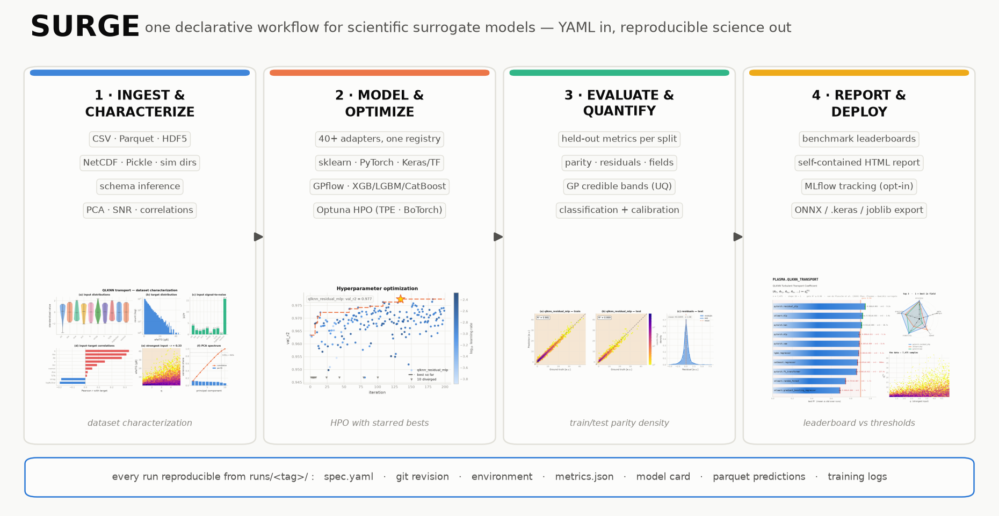
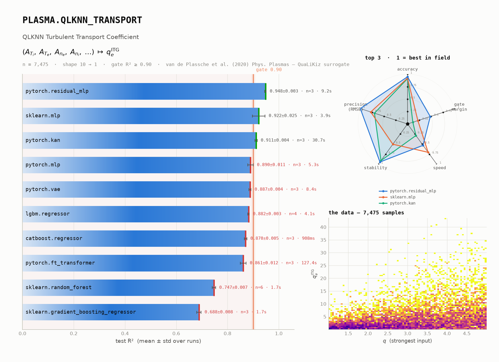
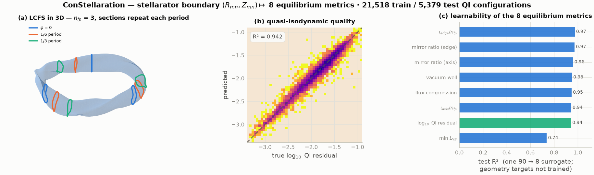
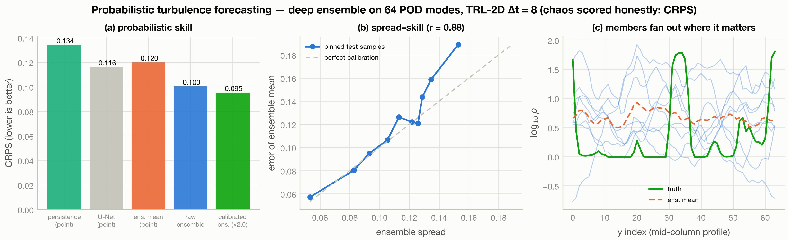

# &nbsp;&nbsp;SURGE

[](https://github.com/S-Villar/SURGE/actions/workflows/ci.yml)
[](./LICENSE)
[](./pyproject.toml)
[](https://github.com/astral-sh/ruff)
[](docs/GETTING_STARTED.md)
[](https://www.osti.gov/doecode/biblio/179819)
[](https://doi.org/10.11578/dc.20260422.5)

**Surrogate Unified Robust Generation Engine** — train, tune, evaluate, and
export scientific surrogate models from a single declarative workflow.
One YAML spec (or Python API) covers
**load → schema → split → train → HPO → metrics → UQ → artifacts → figures**,
with every run reproducible from its own `runs/<tag>/` directory.

**v0.1.0** · [DOE CODE 179819](https://www.osti.gov/doecode/biblio/179819) ·
[DOI 10.11578/dc.20260422.5](https://doi.org/10.11578/dc.20260422.5)

<p align="center">
  <picture><source media="(prefers-color-scheme: dark)" srcset="docs/assets/readme/dark/architecture.png"></picture>
</p>
<p align="center"><sub><em>The workflow by functionality — every thumbnail is a
real SURGE output, regenerated from run artifacts
(<code>python scripts/make_architecture_poster.py</code>).</em></sub></p>

<p align="center">
  
</p>
<p align="center"><sub><em>The same workflow on one real problem — QLKNN turbulent
transport — with every animated panel rendered from run artifacts by
<code>python -m surge.viz.animate</code>: a 200-trial Optuna campaign filling in,
the mission-control dashboard assembling trial by trial, early stopping, held-out
parity, and the leaderboard gaining models against the published gate.
(<a href="docs/assets/readme/surge_end_to_end.mp4">MP4</a>)</em></sub></p>

---

## Why SURGE

- **One workflow, many sciences.** Tabular scalars, multi-output targets,
  1D/2D fields, sequences, and images move through the same pipeline —
  models plug in through a registry, not through per-project scripts.
- **40+ registered model adapters across four ML backends** —
  **scikit-learn** (RF, GBM, ridge, logistic, GPR), boosted trees
  (**XGBoost / LightGBM / CatBoost**), **PyTorch** (MLP families,
  FNO / DeepONet / U-Net operator learners, LSTM/GRU,
  CNN/ResNet/ViT vision, KAN, FT-Transformer, VAE/DDPM/CGAN,
  **Simformer** all-in-one simulation-based inference),
  **TensorFlow/Keras** (`keras.mlp`, or **bring your own compiled
  `tf.keras` model** via `build_fn`), and Gaussian processes with
  predictive uncertainty (sklearn GPR, BoTorch exact/sparse, GPflow).
- **Mix backends in one workflow**: a single YAML spec can train a
  random forest, a PyTorch residual MLP, and a Keras network side by
  side on the same splits — same metrics, same artifacts, directly
  comparable.
- **Automated HPO** (Optuna TPE / BoTorch) with per-epoch training logs
  and starred-best convergence plots.
- **Deployment path**: trained PyTorch surrogates export to **ONNX**
  with `onnxruntime` numeric-parity tests in CI — the route used for
  real-time inference in the ICRF surrogate publications; Keras models
  serialize to the portable `.keras` format, sklearn to joblib.
- **Benchmarks with receipts** (the *model-bench* suite): 30+ curated
  benchmarks from UCI/OpenML to PDEBench, TheWell, MNIST/CIFAR-10, and
  fusion datasets (QLKNN transport, ConStellaration stellarator design),
  each with citation, threshold, and machine-readable results.
- **Provenance by default**: every run stores its spec, git revision,
  environment snapshot, scalers, per-split parquet predictions, and a
  model card.
- **Publication-grade output**: a single visual system produces
  deterministic PNG/SVG/PDF figures (light + dark) and a self-contained
  HTML leaderboard — no server, works on HPC over `scp`.

## Model benchmarking

SURGE ships a curated suite of 30+ benchmarks, each with a citation, a published pass threshold and mandatory baselines, and every run writes machine-readable `result.json` artifacts (repeated seeds, mean ± std, runtime). Not every benchmark is equally mature, so the ledger states per-benchmark status plainly.

**[Full benchmark ledger with per-benchmark status → docs/benchmarks/README.md](docs/benchmarks/README.md)**

<p align="center">
  <picture><source media="(prefers-color-scheme: dark)" srcset="docs/assets/readme/dark/leaderboard.png"></picture>
</p>
<p align="center"><sub><em>QLKNN ITG heat-flux transport: ten models over
repeated seeds — the HPO-tuned residual MLP leads at R² 0.948 ± 0.003
against the published 0.90 gate. The ground truth here is the QLKNN_7_11
network itself (a surrogate scored against a surrogate), so this is a
fast, tutorial-scale leaderboard exercising the full bench → HPO → report
pipeline, not a from-raw-data reproduction — see QLKNN10D below for
that.</em></sub></p>

```bash
surge bench -b plasma.qlknn_transport -m all --seeds 3   # the row above
surge report --out leaderboard.html                      # full dashboard
```

The HTML dashboard adds spider charts per capability domain, per-benchmark dataset previews, citations, tiers, and sortable tables, generated exclusively from `benchmark_reports/**/result.json`.

## Highlights

**Reproducing QLKNN from its own public training data** — the
`plasma.qlknn10d` benchmark trains directly on the 290M QuaLiKiz
gyrokinetic flux calculations behind QLKNN ([Zenodo, CC-BY 4.0](https://zenodo.org/records/3497066)):
a SURGE residual MLP reaches **R² 0.989** on 200k held-out fluxes (ITG
leading flux) after 15 minutes of laptop training on a 2.2M-row
subsample — above the paper-quality 0.95 gate, fully reproducible
end-to-end from public data
([`examples/qlknn10d_study.py`](examples/qlknn10d_study.py)):

<p align="center">
  <picture><source media="(prefers-color-scheme: dark)" srcset="docs/assets/readme/dark/qlknn10d.png"></picture>
</p>

**Stellarator design surrogate — ConStellaration** (Proxima Fusion ×
Hugging Face; Cadena et al. 2025, [arXiv:2506.19583](https://arxiv.org/abs/2506.19583)).
One residual MLP maps the plasma boundary Fourier coefficients
$(R_{mn}, Z_{mn})$ to the 8 stellarator metrics that need it across
26,897 QI-like configurations, replacing the VMEC++ ideal-MHD
equilibrium solve and Boozer-coordinate QI evaluation (minutes per
configuration) — ι on axis/edge, both mirror ratios, vacuum well, min
$L_{\nabla B}$, flux compression, log₁₀(QI) — at **mean R² 0.916** in
the benchmark run (log₁₀ QI alone: R² 0.935; the figure's
saturation-trained model reaches QI R² 0.942). The other 3 ConStellaration
labels (aspect ratio, elongation, triangularity) are computed in closed
form from the boundary coefficients and are not trained at all — the
model never sees them as targets. An optional
`--input-features stellarator_geometry` flag feeds them back in as
physics-informed inputs. Last closed flux surface rendered in 3D:

<p align="center">
  <picture><source media="(prefers-color-scheme: dark)" srcset="docs/assets/readme/dark/constellaration.png"></picture>
</p>

```bash
surge bench -b constellaration_multi -m pytorch.residual_mlp --seeds 3
```

**When chaos caps pointwise accuracy, forecast the distribution** — on the TheWell turbulent radiative layer (non-square 64×192 grid, log-density, Δt = 8) every neural operator beats persistence, but only modestly: **U-Net 0.250 vs persistence 0.355**
([`examples/thewell_turbulence_study.py`](examples/thewell_turbulence_study.py)).
A 7-lever study (architecture, capacity, loss, features, …) showed this
ceiling is predictability-limited, not a modeling gap — so the honest
next move is to change the question: forecast a *distribution*. An
8-member deep ensemble on 64 POD modes, scored with CRPS, reaches
**CRPS 0.095 — 18% better than the best deterministic forecast** — with
spread–skill correlation **0.88**: the calibrated ensemble knows when it
is uncertain
([`examples/thewell_probabilistic_study.py`](examples/thewell_probabilistic_study.py)):

<p align="center">
  <picture><source media="(prefers-color-scheme: dark)" srcset="docs/assets/readme/dark/thewell_crps.png"></picture>
</p>

**A 200-trial HPO campaign** — Optuna TPE over residual-MLP depth, per-block width, learning rate, batch size and dropout on the public QLKNN transport task (1 h 48 min on a laptop CPU). Best validation R² **0.977** (found at trial 134); the refit model reaches **test R² 0.974 vs 0.959** for the earlier 10-trial run. The same artifacts feed the one-look mission-control dashboard (all trial curves, convergence with the starred best, parameter sensitivity, test parity):

<p align="center">
  <picture><source media="(prefers-color-scheme: dark)" srcset="docs/assets/readme/dark/hpo_convergence.png"></picture>
</p>

<p align="center">
  <picture><source media="(prefers-color-scheme: dark)" srcset="docs/assets/readme/dark/mission_control.png"></picture>
</p>

```bash
python examples/viz_theme_gallery.py --only mission_control --hpo-run runs/qlknn_hpo_200_best
```

**Uncertainty and inference** — GP surrogates carry calibrated credible bands that widen where data is absent (96% truth coverage), deep ensembles (`pytorch.mlp_ensemble`) give mean ± 2σ predictions with honest calibration, and the Simformer does simulation-based inference with one network:

<p align="center">
  <picture><source media="(prefers-color-scheme: dark)" srcset="docs/assets/readme/dark/uncertainty.png"></picture>
</p>

Deep ensemble: mean ± 2σ
predictions and honest calibration: raw spread is overconfident; σ-rescaling
on a held-out split recovers near-Gaussian coverage:

<p align="center">
  <picture><source media="(prefers-color-scheme: dark)" srcset="docs/assets/readme/dark/ensemble.png"></picture>
</p>


`pytorch.simformer` is an independent PyTorch implementation of the
Simformer ([Gloeckler et al., ICML 2024](https://arxiv.org/abs/2404.09636)):
one score-based transformer trained on the **joint** p(θ, x) of
simulation parameters and observables. Because the condition mask is a
model input, the same trained network samples the posterior p(θ|x), the
likelihood p(x|θ), or **any conditional** — including inference with
missing observables. Validated against the one SBI problem with a known
closed-form posterior:

<p align="center">
  <picture><source media="(prefers-color-scheme: dark)" srcset="docs/assets/readme/dark/simformer_sbi.png"></picture>
</p>

```python
model = MODEL_REGISTRY.create("pytorch.simformer")
model.fit(x, theta)                        # learns the joint p(theta, x)
model.sample_posterior(x_obs, 1000)        # amortized Bayesian inversion
model.sample_likelihood(theta_0, 1000)     # forward surrogate, same net
model.predict_with_uncertainty(X)          # registry contract: mean, std
```

Regenerate everything above from your own runs — full gallery per
problem type in [`docs/gallery.md`](docs/gallery.md):

```bash
python examples/viz_theme_gallery.py                      # figures, light+dark
surge report --out leaderboard.html                       # interactive dashboard
```

---

## Install

**Requirements:** Python **3.10 – 3.12**. Package name: **`surge-ml`** ·
import name: **`surge`**.

With [uv](https://docs.astral.sh/uv/) (recommended):

```bash
git clone https://github.com/S-Villar/SURGE.git && cd SURGE
uv venv && source .venv/bin/activate
uv pip install -e ".[torch,dev]"
surge version && surge models
```

With plain pip: `python3.11 -m venv .venv && source .venv/bin/activate &&
pip install -e ".[torch,dev]"`.

> PyPI release of `surge-ml` is prepared (`uv build` produces clean
> artifacts — see [`docs/RELEASING.md`](docs/RELEASING.md)); until it is
> published, install from the repository as above.

| Extra | Adds | Install |
|-------|------|---------|
| *(base)* | sklearn, pandas, Optuna, plotting | `pip install -e .` |
| `torch` | PyTorch model families | `pip install -e ".[torch]"` |
| `onnx` | ONNX export + runtime parity tests | `pip install -e ".[onnx]"` |
| `benchmarks` | h5py, Optuna for the benchmark suite | `pip install -e ".[benchmarks]"` |
| `tensorflow` | TF ≥ 2.21 + tf-keras → `keras.mlp` adapter | `pip install -e ".[tensorflow]"` |
| `gpflow` | TF stack for GPflow GPs (then `pip install gpflow --no-deps`) | `pip install -e ".[gpflow]"` |
| `shap` | SHAP feature importance (NumPy-2 compatible) | `pip install -e ".[shap]"` |
| `dev` | pytest, ruff, h5py | `pip install -e ".[dev]"` |

---

## Try it — copy-paste examples

All runs write artifacts to `runs/<tag>/` (`metrics.json`, trained models,
scalers, predictions, spec snapshot).

### 0 · Don't write YAML — generate it (`surge init`)

The wizard inspects your data file, asks three questions (target, goal,
time budget), and writes a fully commented spec; `surge validate` checks
any spec offline with did-you-mean error messages:

```bash
surge init --data my_data.csv            # interactive (or --goal/--budget/--yes)
surge validate spec.yaml                 # unknown keys? typos? bad types?
surge run spec.yaml
```

### 1 · Smoke test (~5 s) — tabular regression

```bash
python -m examples.quickstart --dataset diabetes --model rf --infer
python -c "import json; print(json.load(open('runs/diabetes_rf/metrics.json'))['sklearn.random_forest']['test'])"
```

### 2 · Neural net + HPO (~1–2 min CPU)

```bash
python -m examples.quickstart --dataset california --model mlp --n-trials 5 --infer
```

### 3 · Scientific case — QLKNN plasma transport, two models, HPO

Predict **electron ITG heat flux** (`efeITG`) from 10 gyrokinetic inputs;
one workflow trains **Random Forest + Residual MLP**, each with its own
Optuna search (first run generates the dataset via `fusion_surrogates`):

```bash
pip install fusion_surrogates
python examples/qlknn_multi_hpo_workflow.py --hpo-trials 10 --overwrite
```

### 4 · Mix backends in one spec — sklearn vs PyTorch vs Keras

One YAML, three frameworks, identical splits and metrics:

```yaml
# multi_backend.yaml
dataset_path: my_data.csv
models:
  - key: sklearn.random_forest
  - key: pytorch.residual_mlp
    hpo: {n_trials: 20, metric: val_rmse}
  - key: keras.mlp                      # needs the [tensorflow] extra
    params: {hidden_layers: [64, 64], epochs: 200}
run_tag: backend_shootout
```

```bash
surge run multi_backend.yaml
```

`metrics.json` then holds train/val/test scores for all three on the
same data — and any compiled `tf.keras` architecture of your own plugs
in through the `build_fn` parameter of `keras.mlp` (see
`surge/model/adapters/keras.py`), just as custom PyTorch models plug in
via `examples/custom_cnn_adapter_template.py`. Live example on the
QLKNN transport task — three backends through one registry, and the
small-data regime is exactly where the Gaussian process earns its keep:

| | | |
|:---:|:---:|:---:|
| <picture><source media="(prefers-color-scheme: dark)" srcset="docs/assets/readme/dark/trio_random_forest.png"></picture> | <picture><source media="(prefers-color-scheme: dark)" srcset="docs/assets/readme/dark/trio_pytorch_mlp.png"></picture> | <picture><source media="(prefers-color-scheme: dark)" srcset="docs/assets/readme/dark/trio_gaussian_process.png"></picture> |

### 5 · Your own CSV / Parquet / PKL / HDF5 / NetCDF file

```bash
python examples/custom_dataset_tutorial.py
python examples/run_workflow.py --spec examples/configs/custom_dataset_tutorial.yaml
```

Full guide: [`docs/BUILD_YOUR_OWN_SURROGATE.md`](docs/BUILD_YOUR_OWN_SURROGATE.md)

### 6 · Benchmarks

```bash
surge-benchmark --list                                        # 30+ curated benchmarks
surge-benchmark -b synthetic.regression_1d -m sklearn.random_forest --no-save
surge-benchmark -b tabular.california_housing -m all --seeds 5   # leaderboard, mean±std
surge-benchmark -b pde.burgers_1d --compare-models pytorch.fno1d,pytorch.residual_mlp
```

Verify the install any time:

```bash
pytest -q tests/test_e2e_release_smoke.py   # fast smoke (~seconds)
pytest -q                                   # full suite
```

---

## What you get after a run

```text
runs/<tag>/
├── metrics.json              # train / val / test metrics per model
├── workflow_summary.json     # full run summary + resources + profiling
├── spec.yaml                 # exact config (re-runnable)
├── git_rev.txt, env.txt      # provenance
├── model_card_<model>.json   # data + model provenance card
├── scalers/inputs.joblib
├── models/<name>.joblib|pt
├── predictions/              # parquet per split (y_true / y_pred)
├── training_log_*.jsonl      # per-epoch losses (neural backends)
├── hpo/                      # Optuna trial logs (*_hpo.json)
└── plots/                    # parity, HPO convergence, training dashboards
```

ONNX export (`pip install -e ".[onnx]"`) round-trips PyTorch surrogates
through `onnxruntime` with numeric-parity tests — the path used for
real-time inference deployments.

---

## Visualization system

`surge.viz.theme` is the single source of visual truth: a colorblind-validated
palette (light **and** dark), the signature reversed-plasma density style for
parity plots, reserved status colors for PASS/FAIL, and deterministic
PNG/SVG/PDF export (byte-stable across re-renders, CI-diffable).

```python
from surge.viz.theme import surge_theme, save_figure

with surge_theme("dark") as palette:
    fig, ax = plt.subplots()
    ax.plot(epochs, loss)           # series colors applied automatically
save_figure(fig, "loss")            # loss.png + loss.svg + loss.pdf
```

Per-run figures: `from surge.viz import viz_run; viz_run(Path("runs/<tag>"))`.
Gallery of every figure type: `python examples/viz_theme_gallery.py`.

---

## Run monitoring — mission control

Every HPO campaign leaves machine-readable artifacts, and the gallery renders them as a one-look dashboard (figure in [Highlights](#highlights)):

```bash
python examples/viz_theme_gallery.py --only mission_control --hpo-run runs/qlknn_hpo_200_best
```

## Experiment tracking (MLflow)

Every run's parameters, per-model metrics, and artifacts can be mirrored
to [MLflow](https://mlflow.org) — opt-in, no server required for local
file/sqlite backends:

```yaml
# in any workflow spec
mlflow_tracking: true
mlflow_experiment: my-campaign
```

```bash
surge bench -b tabular.california_housing -m all --mlflow   # benchmarks too
python -c "from surge.integrations.mlflow_logger import log_surge_run; \
from pathlib import Path; log_surge_run(Path('runs/qlknn_multi_hpo'))"
```

<p align="center">
  
</p>
<p align="center"><sub><em>A real SURGE run in the MLflow UI — per-model
train/val/test metrics, parameters, and run artifacts.</em></sub></p>

HPO campaigns are logged as **nested runs**: the parent run links its
trials, and every trial streams its per-epoch `train_loss` / `val_loss`
so the MLflow chart view plots live loss curves per trial:

<p align="center">
  
</p>

## Training at scale

Two levers, both measured on a stock Apple-Silicon workstation
([`scripts/benchmark_scale.py`](scripts/benchmark_scale.py) regenerates
the numbers on your hardware):

```bash
SURGE_DEVICE=auto surge run spec.yaml                    # cuda > mps > cpu
surge bench -b plasma.qlknn_transport -m all --seeds 3 --parallel 4
```

<p align="center">
  <picture><source media="(prefers-color-scheme: dark)" srcset="docs/assets/readme/dark/scale.png"></picture>
</p>

Device selection is deliberately conservative: the default stays
cuda→cpu, and the Apple GPU is **opt-in** (`SURGE_DEVICE=auto`) because
not every architecture is MPS-safe — convolutional and spectral models
are (identical R² to CPU), recurrent models are not. The safety table
lives in [`docs/design/RESOURCE_MANAGEMENT.md`](docs/design/RESOURCE_MANAGEMENT.md),
with the roadmap for in-workflow model parallelism and multi-GPU (DDP).

## Agentic workflows (Claude Code skills)

The repo ships seven skills under [`.claude/skills/`](.claude/skills) that
teach an AI assistant to drive SURGE correctly — spec conventions, the
figure system, benchmark protocols:

| Skill | What it does |
|---|---|
| `surge-wizard` | Q&A → generates a commented `spec.yaml` from your data file and runs it — no YAML by hand |
| `surge-scale` | device selection (MPS safety table), `--parallel` budgeting, long-run monitoring |
| `surge-build-surrogate` | end-to-end playbook: characterize → pick models by task shape → HPO → report |
| `surge-run` / `surge-benchmark` | run workflows / reproduce leaderboard numbers |
| `surge-viz` / `surge-add-model` | figure-system rules / add a new model adapter end-to-end |

Example: point Claude Code at this repo, type `/surge-wizard` with any
CSV, answer three questions (target column, goal, time budget), and it
writes the spec, trains, and reports test metrics against a baseline.

## Documentation

| Topic | Link |
|-------|------|
| **Getting started (one page)** | [`docs/GETTING_STARTED.md`](docs/GETTING_STARTED.md) |
| Build your own surrogate | [`docs/BUILD_YOUR_OWN_SURROGATE.md`](docs/BUILD_YOUR_OWN_SURROGATE.md) |
| First-run walkthrough (HPC) | [`docs/setup/WALKTHROUGH.md`](docs/setup/WALKTHROUGH.md) |
| Install reference | [`docs/setup/INSTALLATION.md`](docs/setup/INSTALLATION.md) |
| Codebase tour | [`docs/SURGE_OVERVIEW.md`](docs/SURGE_OVERVIEW.md) |
| Benchmark definitions & citations | [`docs/BENCHMARK_VERIFICATION_BRIEF.md`](docs/BENCHMARK_VERIFICATION_BRIEF.md) |
| Architecture roadmap | [`docs/design/ARCHITECTURE_RECOMMENDATIONS.md`](docs/design/ARCHITECTURE_RECOMMENDATIONS.md) |
| Doc index | [`docs/README.md`](docs/README.md) |

## SURGE in publications

The methodology and figure conventions above come from peer-reviewed
surrogate-modeling work by the SURGE authors:

- Á. Sánchez-Villar *et al.*, *Real-time capable modeling of ICRF heating
  on NSTX-U and WEST via machine-learning approaches*, **Nuclear Fusion**.
- Á. Sánchez-Villar *et al.*, *Automated ICRF-heating surrogate modeling
  via machine learning*, **EPJ Web of Conferences** (RF Power in Plasmas,
  2026), art. 01005 —
  [epj-conferences.org](https://www.epj-conferences.org/articles/epjconf/abs/2026/02/epjconf_rfppc2026_01005/epjconf_rfppc2026_01005.html).

Software citation: [DOE CODE 179819](https://www.osti.gov/doecode/biblio/179819),
DOI [10.11578/dc.20260422.5](https://doi.org/10.11578/dc.20260422.5),
[`CITATION.cff`](CITATION.cff).

---

## Community

- **Issues:** `.github/ISSUE_TEMPLATE/`
- **Security:** [`SECURITY.md`](SECURITY.md) (private channel — not public issues)
- **Contributing:** [`CONTRIBUTING.md`](CONTRIBUTING.md)
- **Cite:** [DOE CODE 179819](https://www.osti.gov/doecode/biblio/179819),
  DOI [10.11578/dc.20260422.5](https://doi.org/10.11578/dc.20260422.5),
  [`CITATION.cff`](CITATION.cff)

<p align="center">
  
</p>

## License

BSD 3-Clause — see [`LICENSE`](LICENSE) and [`NOTICE`](NOTICE).
