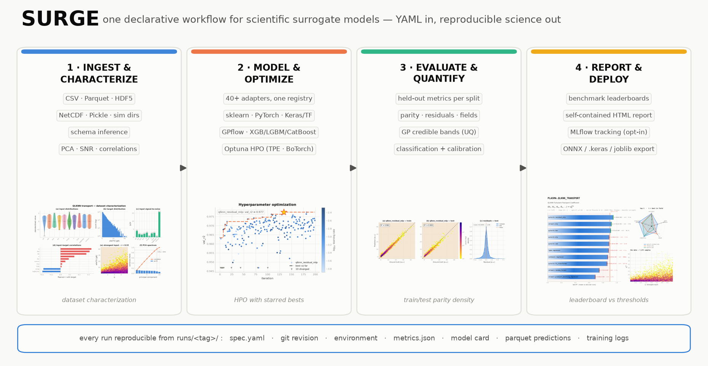
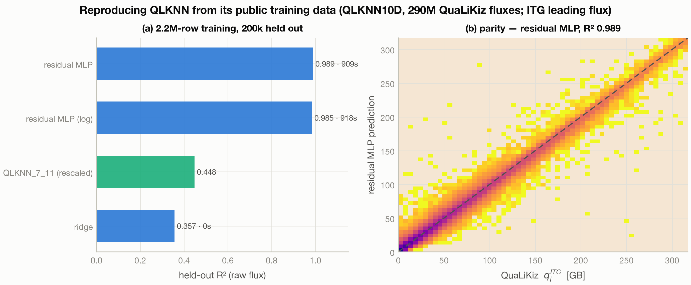

# SURGE — Surrogate Unified Robust Generation Engine

SURGE is a surrogate modeling framework for scientific workflows that
integrates Scientific Machine Learning (SciML) and AutoML features,
uncertainty quantification (UQ), and MLOps-style provenance in a single
declarative pipeline. One YAML spec (or Python API) covers
**load → schema → split → train → HPO → metrics → UQ → artifacts → figures**,
backed by an extensible registry of 40+ model adapters across scikit-learn,
PyTorch, TensorFlow/Keras, and Gaussian-process backends — with every run
reproducible from its own `runs/<tag>/` directory.

**v0.1.0** · License: BSD-3-Clause · [DOE CODE 179819](https://www.osti.gov/doecode/biblio/179819) · DOI [10.11578/dc.20260422.5](https://doi.org/10.11578/dc.20260422.5)



## Install

```bash
pip install surge-ml
```

| Extra | Adds | Install |
|-------|------|---------|
| *(base)* | sklearn, pandas, Optuna, plotting | `pip install surge-ml` |
| `torch` | PyTorch model families | `pip install "surge-ml[torch]"` |
| `onnx` | ONNX export + runtime parity tests | `pip install "surge-ml[onnx]"` |
| `benchmarks` | h5py for the benchmark suite | `pip install "surge-ml[benchmarks]"` |
| `tensorflow` | TF ≥ 2.21 + tf-keras → `keras.mlp` adapter | `pip install "surge-ml[tensorflow]"` |
| `gpflow` | TF stack for GPflow GPs — finish with `pip install gpflow --no-deps` (its published metadata pins numpy<2, unresolvable next to the TF floor above, though GPflow itself runs fine on NumPy 2.x) | `pip install "surge-ml[gpflow]"` |
| `all` | torch + onnx + shap + mlflow + benchmarks + tensorflow (not gpflow — see the no-deps note above) | `pip install "surge-ml[all]"` |

Requires Python 3.10–3.12.

## Quickstart

```bash
surge init --data my_data.csv --target y --yes --out spec.yaml   # write a commented spec
surge validate spec.yaml                                         # schema-check it
surge run spec.yaml                                               # train + evaluate
surge models                                                      # list registered adapters
surge bench -b tabular.california_housing -m all --seeds 5       # leaderboard, mean ± std
surge report --out leaderboard.html                               # self-contained HTML dashboard
```

Every run writes `metrics.json`, trained models, scalers, and per-split
predictions to `runs/<tag>/`.

## Benchmarks

SURGE ships a curated suite of 30+ benchmarks (UCI/OpenML, PDEBench, TheWell,
MNIST/CIFAR-10, and fusion datasets), each with a citation, a published pass
threshold, and machine-readable `result.json` artifacts. Headline numbers
from the ready, gated benchmarks:

- **QLKNN10D plasma transport** — R² 0.989 on 200k held-out QuaLiKiz ITG
  fluxes, reproduced end-to-end from public data (gate R² ≥ 0.95).
- **ConStellaration stellarator design** — mean R² 0.916 across 8 VMEC++
  equilibrium metrics (gate R² ≥ 0.85).
- **Airfoil self-noise** (UCI) — R² 0.957 (gate R² ≥ 0.85).

Full ledger with per-benchmark status: [docs/benchmarks/README.md](https://github.com/asvillar/SURGE/blob/v0.1.0/docs/benchmarks/README.md).



## Learn more

- [Full README](https://github.com/asvillar/SURGE/blob/v0.1.0/README.md) — architecture, highlights, visualization system, all 40+ model adapters
- [Getting started](https://github.com/asvillar/SURGE/blob/v0.1.0/docs/GETTING_STARTED.md)
- [Changelog](https://github.com/asvillar/SURGE/blob/v0.1.0/CHANGELOG.md)
- [Citation](https://github.com/asvillar/SURGE/blob/v0.1.0/CITATION.cff) — DOE CODE 179819, DOI [10.11578/dc.20260422.5](https://doi.org/10.11578/dc.20260422.5)

## License

BSD-3-Clause — see [LICENSE](https://github.com/asvillar/SURGE/blob/v0.1.0/LICENSE) and [NOTICE](https://github.com/asvillar/SURGE/blob/v0.1.0/NOTICE).
