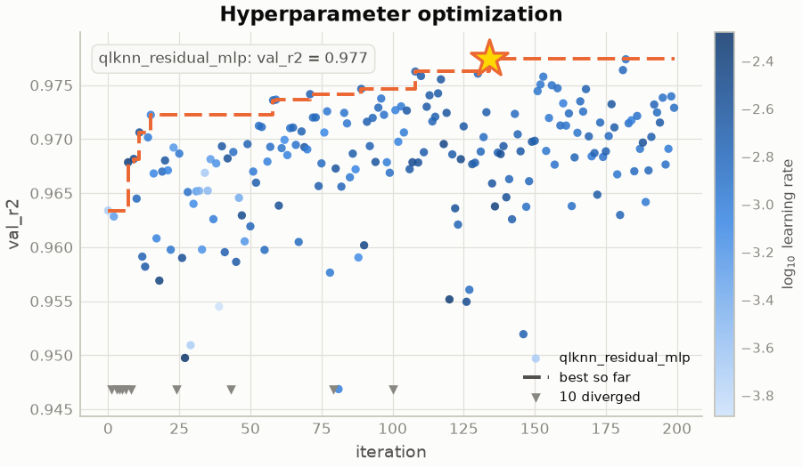
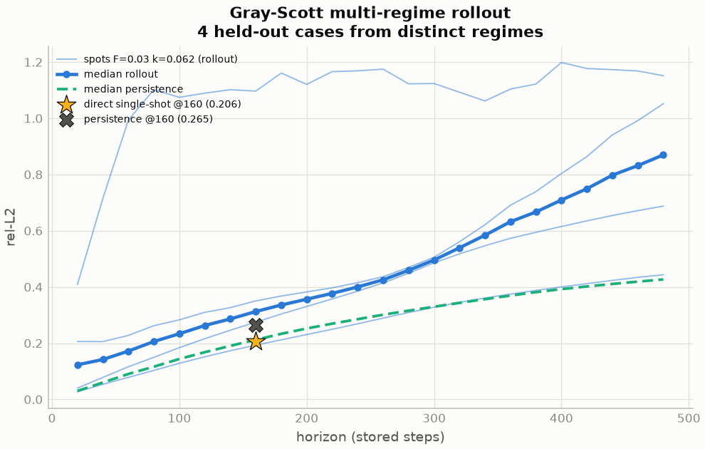
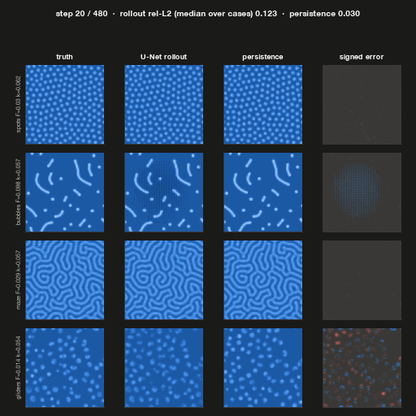
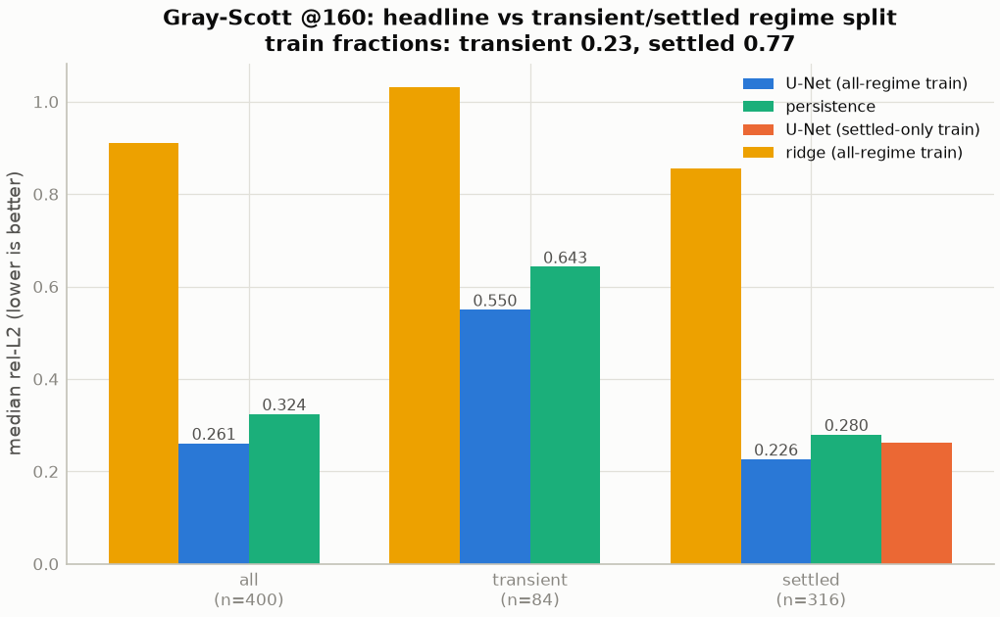
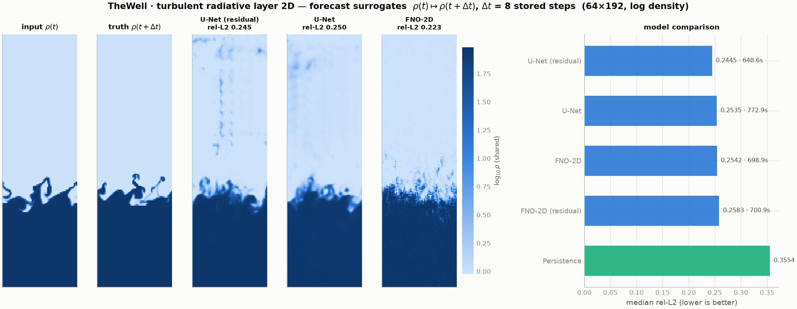
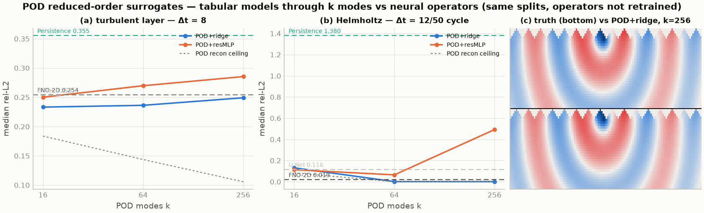
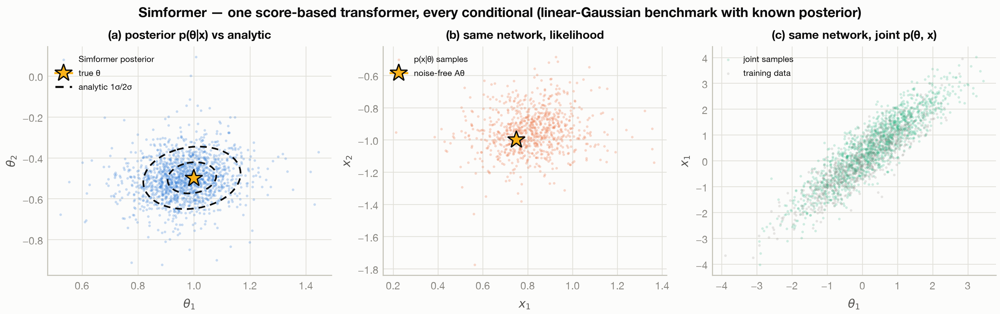
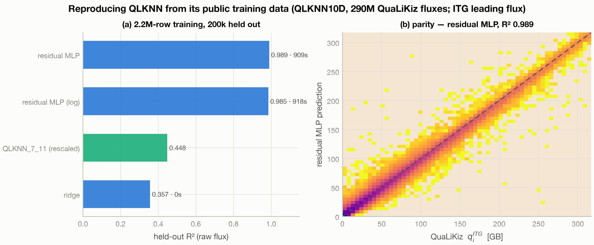
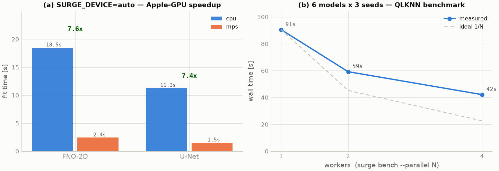
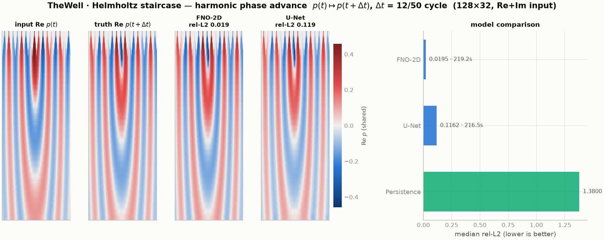

# Results gallery

What SURGE produces, by problem type. Every figure below is generated
from machine-readable run artifacts by the SURGE visual system — nothing
is hand-drawn or hand-entered. Regenerate all of them (light **and**
dark variants, deterministic PNG/SVG/PDF) with:

```bash
python examples/viz_theme_gallery.py
python scripts/sync_readme_assets.py                        # curate into docs/
python -m surge.report.leaderboard --out leaderboard.html   # dashboard
```

## Tabular regression

Parity density in the SURGE signature style — reversed-plasma colormap,
log-scaled counts, train/test panels, R² boxes — here for the QLKNN
ITG heat-flux surrogate (random-forest baseline; the HPO-tuned residual
MLP reaches R² 0.96 on the same task).


## Hyperparameter optimization

Per-model Optuna history: solid per-trial trace, dashed running best,
gold star at each model's optimum with its score.



## Neural-network training

Per-epoch train/validation loss from the JSONL training logs: shaded
generalisation gap, best epoch marked, power-law convergence fit, and
smoothed early stopping (patience on the rolling-mean validation loss)
terminating training at true saturation.


## Classification

ROC, precision–recall, confusion matrix (counts + shares), and a
reliability diagram with per-bin calibration gaps and ECE.


## Operator learning (fields / PDEs)

Burgers' equation surrogate trained through the registry: best / median /
worst test samples, the signed-error field over the whole test set
(sorted by per-sample rel-L2), and the error distribution.


## In progress — Gray-Scott forecasting (direct 160-step U-Net 0.206 vs persistence 0.265 holds in both regimes; stepping does not beat persistence; see --rollout-longjump)

Moved here from the README: this is work in progress, not a headline result. Status: `in_progress` in [`benchmarks/README.md`](benchmarks/README.md).

Operator forecasting on the Gray-Scott reaction–diffusion system from
[TheWell](https://polymathic-ai.org/the_well/) (Ohana et al., NeurIPS
2024): predict the 64×64 species-B field 160 stored steps ahead. The
horizon is set where the persistence baseline ("predict no change",
green bar) visibly fails — at single-step the task is trivial
(persistence rel-L2 0.002). U-Net with a residual target leads (median
rel-L2 0.206) and is the only architecture beating persistence (0.265);
FNO-2D blurs the sharp Turing interfaces at this horizon and DeepONet's
global low-rank basis cannot localize. Reproduce with:

```bash
# note: the full Gray-Scott archive is ~132 GB (117 train + 15 valid)
python -c "from surge.benchmarks.loaders.thewell import download_thewell; download_thewell('gray_scott')"
python examples/thewell_grayscott_study.py
```


Scored from settled pattern states on four held-out regimes (spots,
bubbles, maze, gliders), a Δt = 20 U-Net rolled out for 24 applications never
beats persistence: median rel-L2 0.31 vs 0.21 at 160 steps and 0.87 vs
0.43 at 480; the bubbles case develops a checkerboard instability and the
gliders dissolve. Only the direct single-shot 160-step model (0.206 vs
persistence 0.265) beats "no change". Rollouts started in the first ~200
pattern-forming steps score very differently and are not a fair test.

```bash
python examples/thewell_grayscott_study.py --rollout-gif
```





Honest numbers: the stepping model already loses to persistence at a single step (0.17 vs 0.04), sits at median rel-L2 0.31 vs 0.21 after 160 steps and 0.87 vs 0.43 at 480.

A regime-split re-score of
the 160-step task (`--regime-split`, 400 test pairs) shows the direct
model's margin holds in both regimes — settled 0.226 vs persistence 0.280,
transient 0.550 vs 0.643 — and that a U-Net trained on settled pairs only
is worse on settled data (0.263), so the transient examples act as useful
signal rather than inflating the headline.




The single-step task (`--horizon 1`) exists too and shows why the
horizon matters: every model — even residual DeepONet at rel-L2 0.020 —
loses to persistence at 0.002, so a leaderboard on it would measure
nothing.


## External PDE benchmark — TheWell turbulent radiative layer

A second Well system, with the opposite verdict to Gray-Scott: on this
fast-mixing task (64×192 non-square grid, log density, Δt = 8 stored
steps) every neural operator beats persistence — U-Net 0.250 and FNO-2D
0.256 vs 0.355 — each trained in ~4 min on the Apple GPU
(`SURGE_DEVICE=auto`).

```bash
python -c "from surge.benchmarks.loaders.thewell import download_thewell; download_thewell('turbulence_2d')"  # ~6 GB
SURGE_DEVICE=auto python examples/thewell_turbulence_study.py
```



## POD reduced-order surrogates

`pod_fit/pod_transform/pod_inverse` (surge.preprocessing) turn any
tabular model into a field surrogate through k POD modes. On the
chaotic turbulent layer, POD+ridge still edges the U-Net — always run
the ROM baseline before reaching for an operator network. The dotted
line is the POD reconstruction ceiling (representation limit at each k).
Panel (a) (turbulent layer) is the live result; panels (b)/(c) in the
figure carry the retired Helmholtz linear-identity case (see "Sanity
checks" below) and are kept as-is, not regenerated.



## Probabilistic turbulence forecasting (CRPS)

Pointwise error on the turbulent layer is chaos-limited (7-lever study),
so the honest forecast is a distribution: an 8-member deep ensemble on
64 POD modes. Calibrated CRPS 0.095 beats the best point forecast by
18%, with spread–skill correlation 0.88.


## Simulation-based inference — Simformer

One score-based transformer over the joint p(θ, x) samples every
conditional: posterior, likelihood, joint, or inference with missing
observables (`pytorch.simformer`, Gloeckler et al. ICML 2024).
Validated against the linear-Gaussian benchmark's closed-form posterior.



## Reproducing QLKNN from source data (QLKNN10D)

Trains directly on the public 290M-row QuaLiKiz table behind QLKNN
(Zenodo 10.5281/zenodo.3497066): residual MLP R² 0.989 on 200k held-out
ITG leading fluxes from a 2.2M-row subsample, 15 min on a laptop —
above the paper-quality 0.95 gate. The shipped QLKNN_7_11 network
evaluated cross-generation scores 0.45 here (different data generation
and flux normalisation — convention, not necessarily quality).



## Stellarator design — ConStellaration

One residual MLP maps stellarator plasma-boundary Fourier coefficients
(R_mn, Z_mn; n_fp = 3) to the 8 stellarator metrics that need the VMEC++
equilibrium solve, across 26,897 QI-like configurations (Cadena et al.
2025, arXiv:2506.19583): real rotating boundary cross-sections, log₁₀(QI)
parity at R² 0.942 (figure's saturation-trained model), and learnability
of all 8 metrics (mean R² 0.916 in the benchmark run). The other 3
ConStellaration labels (aspect ratio, elongation, triangularity) are
computed in closed form from the boundary coefficients and are not
trained at all.


## HPO mission control

The per-trial artifacts of an HPO campaign rendered as a one-look
dashboard: all validation-loss curves with the winning trial highlighted,
search convergence with the starred best, run-summary card, best-trial
train/val detail, parameter sensitivity, and the tuned model's test
parity.


## Multi-backend comparison

Random forest, PyTorch MLP, and an exact Gaussian process trained on
identical QLKNN splits through the one registry — the small-data regime
is where the GP earns its keep.


## Deep-ensemble uncertainty

`pytorch.mlp_ensemble` mean ± 2σ with honest calibration: raw ensemble
spread is overconfident; σ-rescaling on a held-out split recovers
near-Gaussian coverage.


## Uncertainty quantification

Gaussian-process surrogate with nested 68/95% credible bands — the band
widens where training data is absent; truth coverage is annotated.


## Dataset characterization (pre-training)

Input distributions, target distribution, signal-to-noise, input–target
correlations, the strongest single relationship, and the PCA variance
spectrum with effective dimensionality.


## Training at scale

Measured on a stock Apple-Silicon workstation
(`scripts/benchmark_scale.py` regenerates on your hardware): opt-in GPU
via `SURGE_DEVICE=auto` (7–8× for the 2D operator models, identical R²)
and the `surge bench --parallel N` subprocess fan-out against ideal 1/N.



## Benchmark leaderboards

Score ± std across repeated runs against the published threshold, with
runtime on a separate log-scale panel. The interactive HTML dashboard
(`surge report`) adds spider charts, per-benchmark dataset previews,
citations, and sortable tables.


## Sanity checks — linear identities (not surrogate results)

These three used to appear as headline results; they are kept here as
regression checks because each task turns out to be a closed-form
linear map that ridge regression (or a one-sample spectral fit) solves
exactly, so a neural operator "winning" is not evidence of learning
nonlinear physics.

**Periodic Poisson (2D field-operator sanity check).** FNO-2D learns
source→solution at median rel-L2 0.006 on 32×32 fields — but the
target is exactly `f_hat / |k|²` in Fourier space, a linear spectral
multiplier: ridge regression hits rel-L2 1e-9 in 0.1 s. Useful as an
FNO unit test, not a surrogate-learning result.


**TheWell Helmholtz staircase (harmonic phase advance).** Advancing the
(Re, Im) standing-wave pressure quadratures by ¼ cycle is a pointwise
2-parameter rotation, `Re p(t+Δt) = cos(ωΔt)·Re p(t) + sin(ωΔt)·Im p(t)`;
persistence fails at rel-L2 1.38 only because the phase shift is near
orthogonal, not because the dynamics are hard. FNO-2D reaches 0.0195,
but POD+ridge already reaches 0.0017 — 11x better — because the map is
linear, not because of any wave-physics advantage.



**Helmholtz autoregressive rollout.** The animated rollout is the same
pointwise rotation applied recursively 24 times over one harmonic
cycle — a repeated linear identity, not evidence of long-horizon
generalization. GIF retained at
[`docs/assets/readme/helmholtz_rollout.gif`](assets/readme/helmholtz_rollout.gif)
but no longer embedded in the README.
